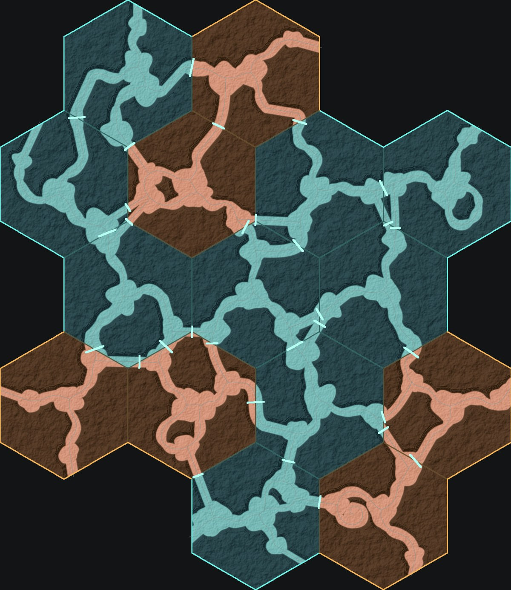
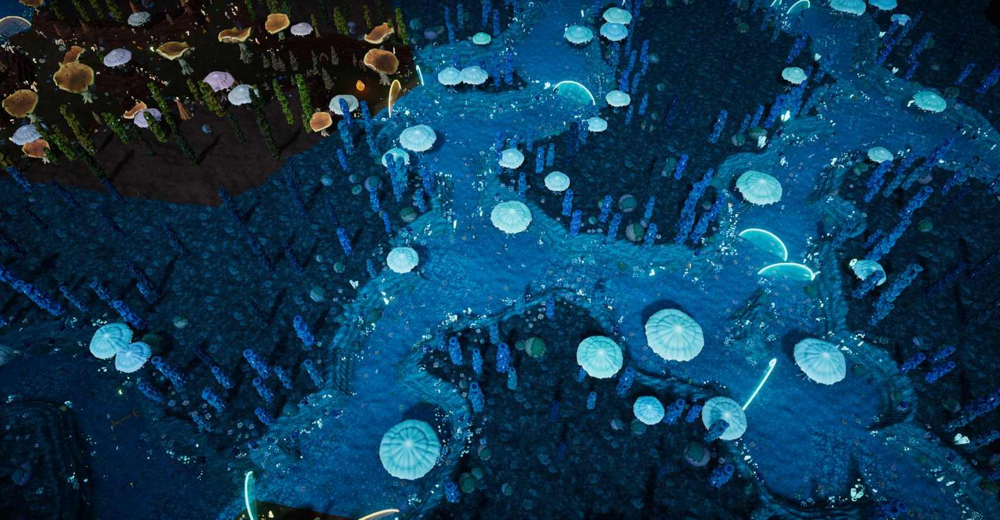
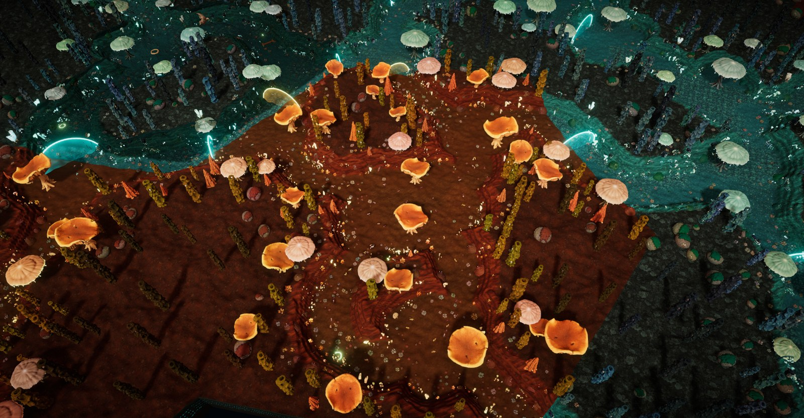
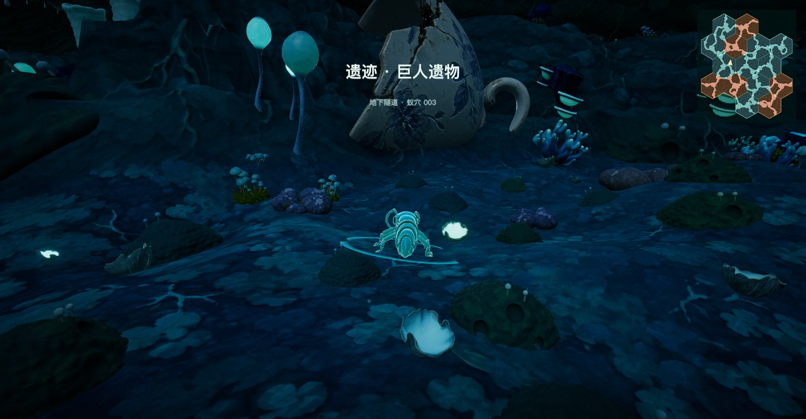
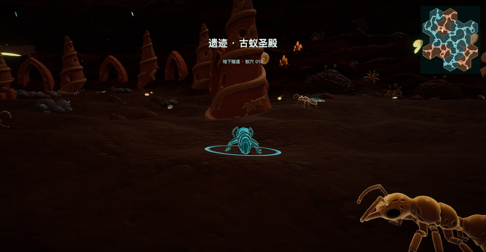
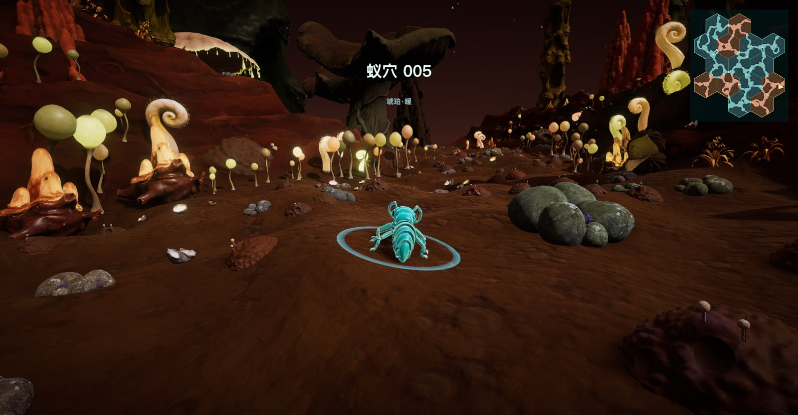

# 报告：所有蚁穴拼成蜂巢（2026-10-13）

## 一句话结论

所有蚁穴（13 个，含 2 个遗迹隧道）现在拼成一整块蜂巢：六边形边贴边，峡谷穿过接缝连通，全程走路就能到，不再用虚线传送门。高画质下全程 55–60 帧（M3 Max），加载约 24 秒。Mac 版和 Windows 版都已打包。

## 1. 现在的样子

- **15 个六边形**，从中间往外两圈排开：
  - 中心：蓝色蚁穴 001。
  - 第一圈：002、003（和 001 组成原来的蓝色三穴）、琥珀 010、遗迹 · 巨人遗物、遗迹 · 古蚁圣殿、蚁穴 004。
  - 第二圈：005–009、011–013，蓝色和琥珀色交替。
- **接缝**：每块六边形都会自动转到合适的角度，让两边峡谷的出口尽量对上，再用一段 S 形峡谷穿过接缝。接缝上站着一道蓝绿色光门，走过去就进入隔壁蚁穴，屏幕中间会显示它的名字。
- **地面**：整块蜂巢只有一张连续的地面网格，接缝处没有裂缝。蓝色苔藓和琥珀干土沿六边形的边直线分开，就是蜂巢格子的样子。
- **小地图 / 大地图**：都是整块蜂巢，点任意位置都能传送过去。

两个遗迹在蜂巢里照常工作：隧道顶、遗物、对话都在，进入时屏幕中间写"遗迹 · 巨人遗物 / 古蚁圣殿 · 地下隧道"。

## 2. 怎么做的

- **拼接器**（`Scripts/Core/Stitcher.cs`）：
  - 原来只会拼一排或三角形的三块，新增"蜂巢"排法，最多 19 格。
  - 选每块转多少度：原来是把 6 的 (块数−1) 次方种组合全部试一遍，15 块时有 6^14 种，算不完。
  - 现在超过 6 块时改用"逐块挑最合适的角度、反复几轮、从 12 个起点各试一次、取最好"。结果是固定的，每次打开都一样。
  - 原来的一排、三角两种排法完全没动，所以和网页原型的逐位对照测试不受影响。
- **每格一个区域，共用一块地形**（`World.AddCells`）：
  - 每个六边形有自己的颜色、遗迹、蚁群；高度、峡谷、碰撞都来自同一块拼好的地形，所以走过接缝是连续的。
  - "我在哪一格"由坐标直接换算，几乎不花时间。
- **地面网格**（`TerrainBuilder.BuildCells`）：跨格的三角形沿六边形的边精确切开，两边各用自己的材质，所以不会有裂缝或锯齿。
- **植物、蚂蚁、遗迹**：
  - 每格只在自己的六边形里种植物；外圈的远景大树只长在蜂巢外缘。
  - 蚂蚁在自己那一格的路上活动。
  - 遗迹的隧道顶只盖住自己那一格，布置遗物时只沿本格自己的峡谷走，跨格的连接段不算。
- **蜂巢里不再有虚线传送门**；外圈峡谷通到边缘的出口不再跳到别的世界。

## 3. 性能

| | 加载 | 游玩帧率（M3 Max） | 植物 | 蚂蚁 |
|---|---|---|---|---|
| 高画质 | 约 24 秒 | 55–60 | 约 28 000 | 约 840 |
| 中画质（Windows 新装默认） | 约 18 秒 | 56–60 | 约 24 700 | 约 550 |

拼成蜂巢后，邻居格子全都在视野里，高画质一度掉到 30 帧，局部掉到 10–20 帧。为此做了三处调整：
- **植物按距离剔除**：小中型植物 115 单位外不画（高画质，中画质 110），大树 260 单位外不画。那里早已被夜雾盖住，看不出差别。
- **蚂蚁按格子活动**：只有你所在的格子，以及你靠近接缝时的隔壁格子，蚂蚁才活动。
- **高画质关掉环境光遮蔽**，阴影距离从 80 收到 50。这一项影响最大，关掉后掉帧消失了。代价是植物根部的暗部略浅；想要回来，把 `GameConfig.cs` 里 high 的 `ao` 改回 `true`。

## 4. 这一轮顺带修好的问题

- **切换世界会卡死**：从地图下排按钮跳到巨人遗物等场景、走出口、按 Tab 换画质都会卡住。原因是重新加载场景后游戏主体没有重建，已修复。
- **和蚂蚁交互**：原来选中的常是身后或画面外的蚂蚁，现在选正前方最近的那只。蚂蚁、物件位、出口都在附近时，谁离你最近就和谁交互。

## 5. 需要你看一下的地方

1. **格子之间的颜色是直线切开的**：蓝色和琥珀相邻处是一条笔直的边，我理解这正是蜂巢的感觉。如果想让土色在接缝处慢慢过渡，可以再加。
2. **颜色怎么排**：外圈 8 个蚁穴现在是蓝色、琥珀交替排的，琥珀格的位置有点随机。想要别的排法（比如琥珀集中在一侧）告诉我。
3. **隧道口**：两个遗迹格子的隧道顶在格子边上直接结束，形成一个"隧道口"，正好对着接缝光门。这里我只在地图和截图里看过，还没在游戏里近距离走过。
4. **外圈边缘的出口**现在是死路（峡谷通到外框就结束）。如果希望外缘还能通往别处，再定。

## 6. 怎么改回去

`GameConfig.cs` 的 `defaultWorld`：
- 现在：`honeycomb:path-001@blue,path-002@blue,…`（蜂巢）。
- 原来的两区群岛：`stitch:cluster:path-001,path-002,path-003@blue|path-010@amber`。

## 7. 暂停中的事

- 新植物第三版候选（`02_Concepts/Plants_v12_候选/00_候选三版对照.jpg`）还在等你挑，挑好后再用 Tripo 建模。
- 按你的要求，交完这份报告就先停下。
