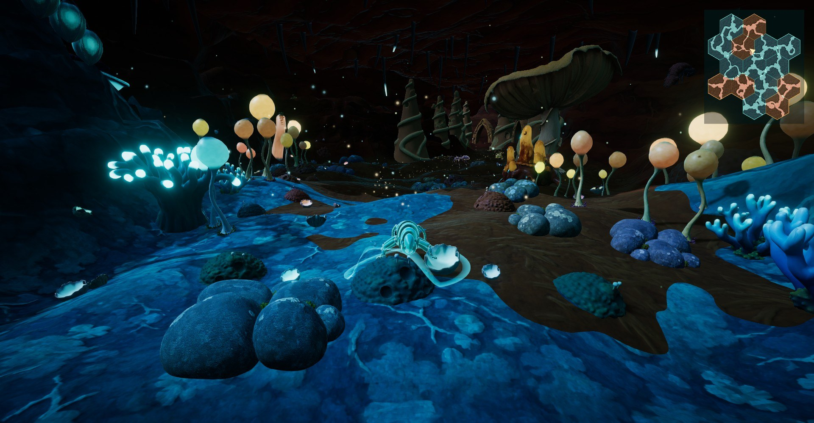
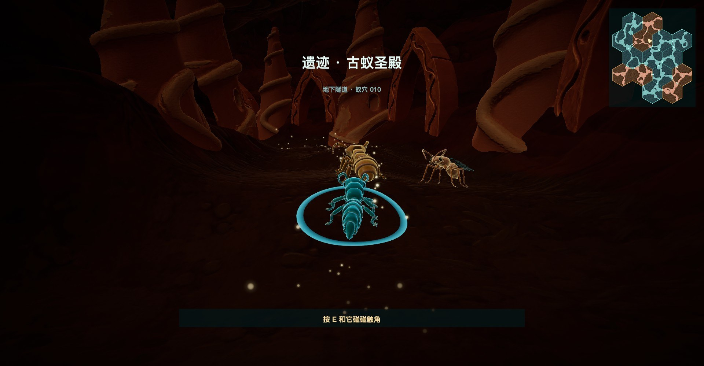
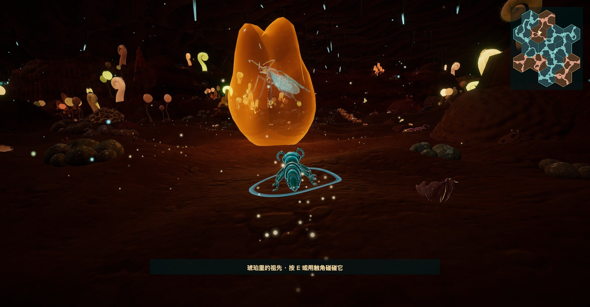
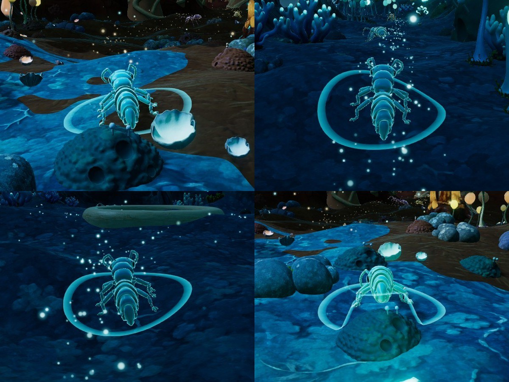

# 报告：遗迹隧道、引路光点、蚁穴接缝（2026-10-16）

## 一句话结论

两处遗迹从"广场"改成了窄隧道，物件按走进去的顺序排开，尽头是核心。地上撒着有疏有密的光点，细小的光尘朝核心飘，指明该往哪走。蚁穴之间的接缝不再是一条直线：两边的土色以斑块互相渗透，接缝上缓缓升起光粒。隧道里画面稍暗（约 15%），玩家脚下的光圈贴着地面。演示视频在 Releases：`ruins_tunnels_guide_trail.mp4`。

## 1. 接缝：粒子和土色渗透，不再是直线

- 地面：接缝两侧约 4.5 个单位内，邻居的地面以噪声斑块盖上来，越靠近接缝越多。两边用同一个斑块图案，所以斑块在接缝上严丝合缝。
- 光粒：每条接缝上缓缓升起，峡谷经过处最密；颜色是两边蚁穴各自的发光色。
- 原来接缝上的光门拱去掉了。

## 2. 遗迹改成窄隧道

- 峡谷宽度乘 0.55，洞室跟着缩小；隧道顶压低（4.6 / 5.8）。
- 物件从入口往里排，尽头是核心：巨人遗物的纽扣广场、古蚁圣殿的琥珀神龛。
- 普通蚁穴的形状完全没变：核心算法和网页原型的逐位对照测试 11 组全部通过。

## 3. 引路光点

- 第一版是两排整齐的脚印加一道往前流动的光波，太像跑道灯。按反馈改成现在这样：
  - 光点自然散落，有密有疏，大小、亮度、闪烁节奏各不相同；
  - 细小的光尘沿路朝核心飘，用流动表示方向；
  - 平时偏暗，蚂蚁走近时微微变亮，身后留一点余光，前方十来步更亮。
- 路线两侧的植物自动让开，留出一条小路。
- 地上的光点做成始终正对镜头的小光斑，因为平贴在地上的光点从低角度看会压成细线，远处就看不见了。

## 4. 明暗和光圈

- 整体曝光略降；进隧道再暗约 15%，蚂蚁自身的发光也同步减弱，不会和环境差太多。中间试过更暗的版本（约暗 70%），太黑、蚂蚁太突兀，已经调回。
- 玩家脚下的光圈每帧贴着地面铺开。

## 5. 可调的数值

都写在 `game_config.json` 里，不用重新打包：`ruinWidth`、`trailBrightness`、`trailDensity`、`seamMotes`、`seamMoteDensity`、`seamBlend`、`atmosphere.exposure`、`atmosphere.tunnelAmbient` / `tunnelMoon` / `tunnelRim` / `tunnelAntDim` / `tunnelExposure`。含义见 [Unity 版操作说明](../../Unity版_操作说明.md)。

## 6. 还要看的

1. 在 Windows 演示机上试玩：光点够不够明显，隧道的暗度是否合适。
2. 蓝色与蓝色蚁穴之间的接缝只有光粒、没有土色变化（同一种地面），是否也要区分。
