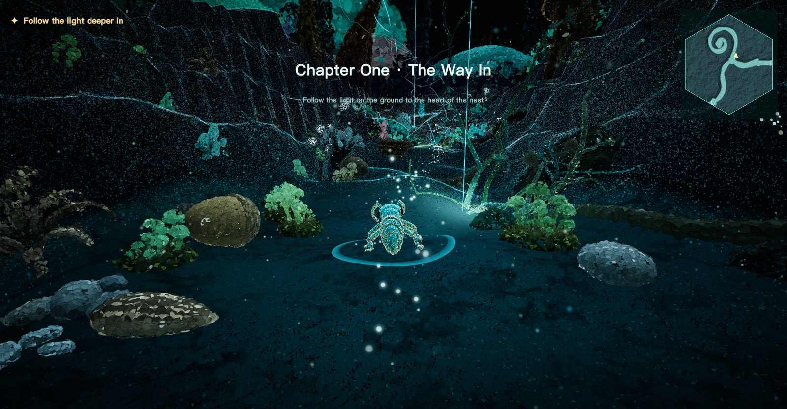
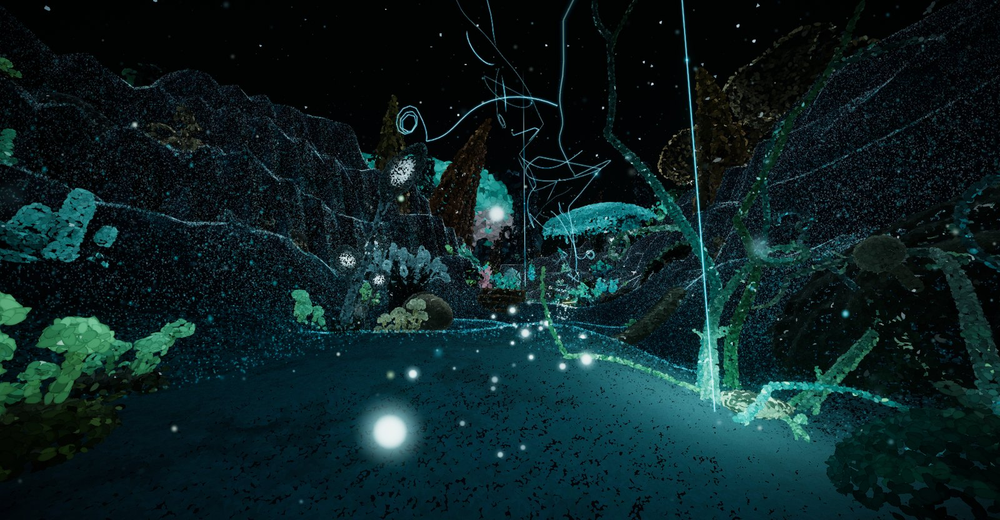
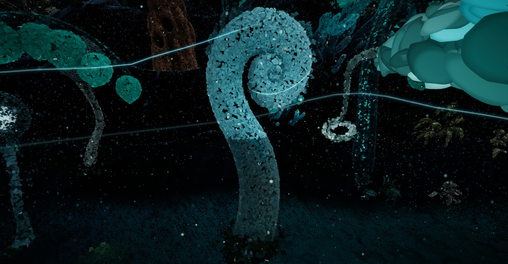
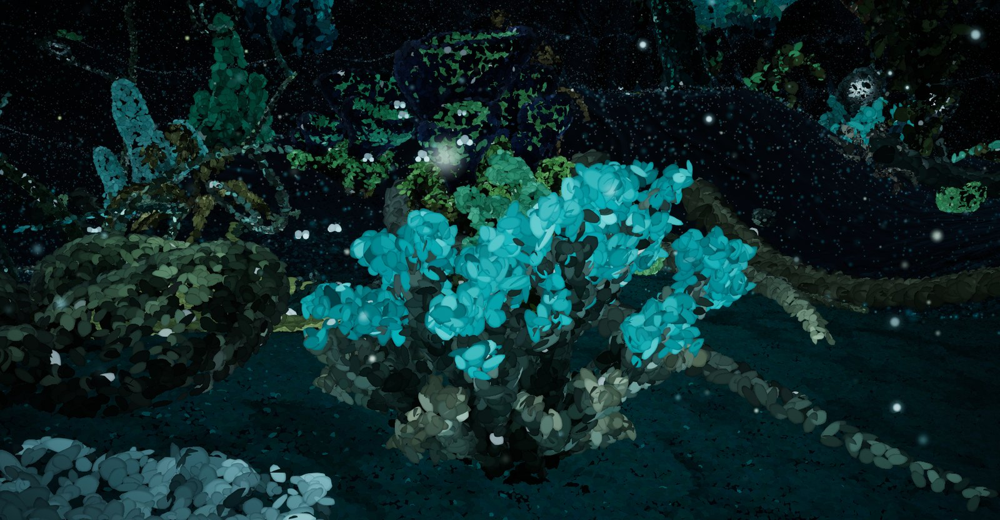
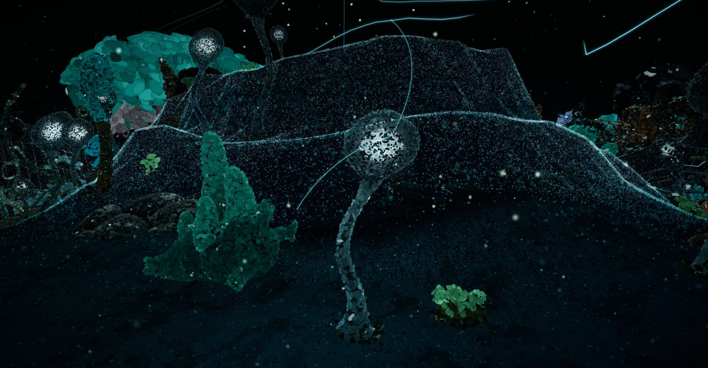
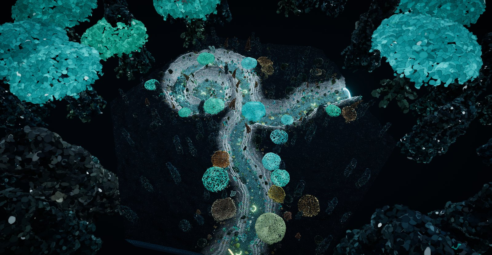
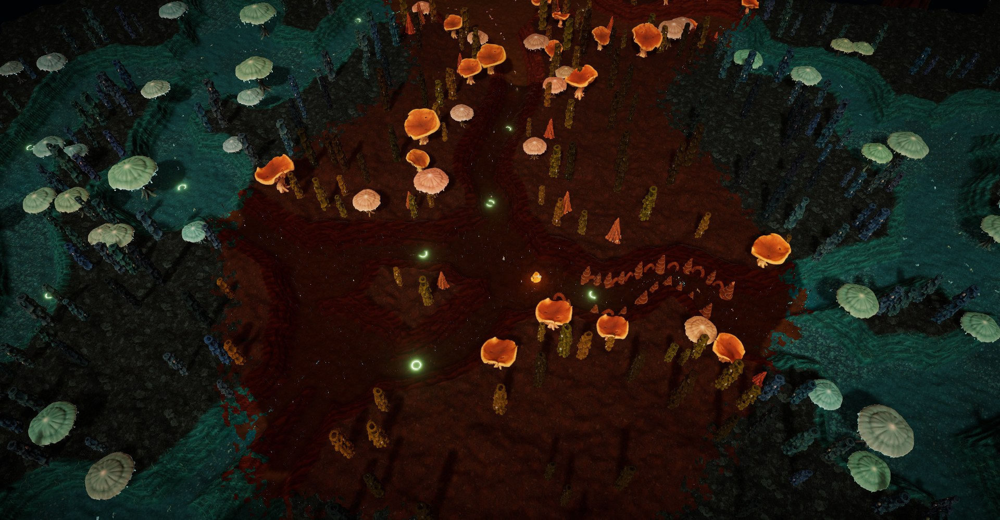
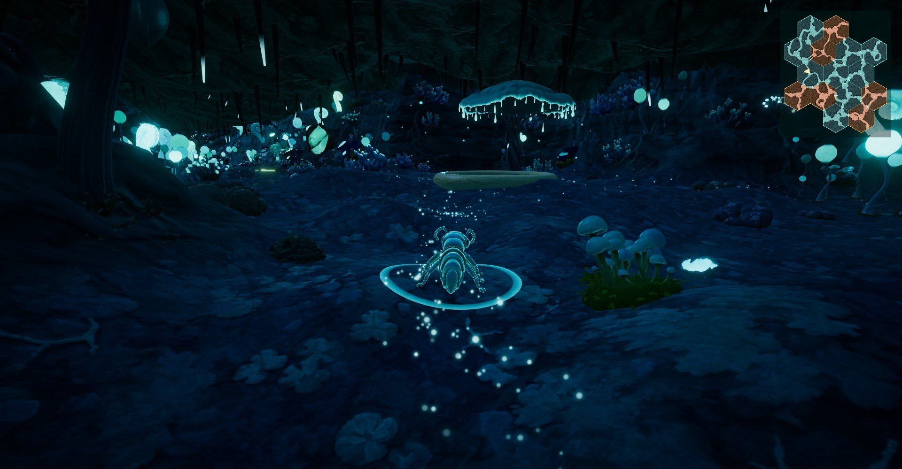

# 蚂蚁花园 Ant Garden

UCL DFPI 毕业设计。把真实蚂蚁巢穴的路径图变成一座座峡谷般的蚁穴，玩家控制一只蚂蚁在里面爬行、和蚁群碰触角、点亮发光植物、发现遗迹，以后还会读到前一位访客留下的故事。画风是《风之谷》腐海的夜晚。

- **引擎**：Unity 2022.3.62f3c1（国内版 Hub 的 "c1" 版本），Built-in 渲染管线 + Post Processing v2
- **语言**：C#；工具脚本用 Python / Node / zsh
- **演示平台**：Windows 电脑（Mac 上开发和测试）
- **当前状态（2026-10-22）**：
  - **`main` 分支**：可玩的演示（2026-10-16）。13 个蚁穴加 2 处遗迹拼成一整块蜂巢；两处遗迹是窄隧道，地上的光点引路；蚁穴之间的接缝用粒子和土色渗透过渡；支持键盘鼠标和 Xbox 手柄；有音效，没有背景音乐。
  - **`experiment/particle-look` 分支**：粒子蚁穴实验，还没合进 `main`。一个蚁穴（第一章 · 入口）整个用粒子来画：植物、墙、地面、蚂蚁都是点；光柱和光丝引路，光柱脚下长着藤蔓；植物带会呼吸的微光，走过时会亮；新加了 7 种高精度建模的植物。

> **只想玩一下**：去 [Releases](https://github.com/805200470-sketch/antchitecture/releases) 下载 Windows 或 Mac 版（目前是 10-16 的 `main` 版本），说明在 [`07_Outputs/`](07_Outputs/)。
>
> **想看粒子蚁穴**：切到 `experiment/particle-look` 分支（见[第 2 节](#2-两个分支)），截图在下面。
>
> **第一次来、要参与制作**：先看[第 1 节：从前期到后期](#1-先看全貌从前期到后期)，知道整个项目分几段、哪段由谁负责；再读 [**项目地图**](Docs/项目地图/)：
>
> 1. [从装置到资产与动画](Docs/项目地图/1_从装置到资产与动画.md)：流程、工具、每一步的产出在哪
> 2. [交互分类](Docs/项目地图/2_交互分类.md)：玩家能做的每一件事
> 3. [改动影响表](Docs/项目地图/3_改动影响表.md)：改了什么会牵动什么，改完要做什么
> 4. [体验与产出](07_Outputs/)：怎么玩，所有产出的清单
>
> 改任何东西之前，先看[第 4 节：哪些能改、哪些不能改](#4-改东西之前先看三类)。细节查 [`Docs/Unity版_操作说明.md`](Docs/Unity版_操作说明.md)。

---

## 截图

### 粒子蚁穴（`experiment/particle-look`，2026-10-22）

| | |
|---|---|
|  |  |
| 进入蚁穴：第三人称，右上角是小地图 | 蚂蚁视角：一道光柱和它脚下的藤蔓 |
|  |  |
| 卷头植物：只有头发青光，慢慢呼吸 | 新植物：分枝珊瑚（Tripo 高精度建模） |
|  |  |
| 玻璃泡植物：稀疏的点壳里有一团光 | 整个蚁穴的鸟瞰 |

全部 13 张在 [`Docs/screenshots/unity_v10_粒子蚁穴/`](Docs/screenshots/unity_v10_粒子蚁穴/)（`00_总览.jpg` 是缩略图）。

### 原版（`main`，2026-10-16）

| | |
|---|---|
|  |  |
| 蜂巢接缝和古蚁圣殿（鸟瞰） | 遗迹隧道里的引路光点 |

更早的截图在 [`Docs/screenshots/`](Docs/screenshots/)，每个版本一个文件夹。

---

## 1. 先看全貌：从前期到后期

整个项目分五段。中间那段（游戏世界）是这个仓库的主体，前期和后期还有几块留着位置，等负责的同学补上。

```
装置（真实蚁穴）→ 路径识别 → 游戏世界 → 用户上传 → 展示
      前期           前期       中期        后期       后期
```

| 阶段 | 做什么 | 现在的状态 | 放在哪里 | 负责人 |
|---|---|---|---|---|
| 前期 · 装置 | 真实蚂蚁在装置里挖出通道，拍照或描线留下记录 | 🟡 **预留**：只有结果（13 张线稿），装置照片和过程还没记录 | `01_References/Photos/`（目前为空）；说明写进[项目地图 1](Docs/项目地图/1_从装置到资产与动画.md) | 待填 |
| 前期 · 路径识别 | 线稿 → 路径网络（节点、通道、宽度，JSON） | 🟢 工具和 13 份结果都在；🟡 **预留**：操作步骤和检查方法，见 [1.1](#11-预留--前期路径识别) | `04_Paths/` | 待填 |
| 中期 · 游戏世界 | 路径网络 → 峡谷、植物、遗迹、蚂蚁、光和声音 | 🟢 `main` 可玩；🔵 粒子蚁穴在实验分支上 | `UnityProject.nosync/` | 待填 |
| 后期 · 用户上传 | 访客留下照片和一句话，变成蚁穴里的物件；蚂蚁碰触角能读到，还会把它带到别处 | 🟡 **预留**：只有交互设计草案和占位的物件位，见 [1.2](#12-预留--后期用户上传) | 设计草案：[`Docs/设计_触角交流与留下的故事.md`](Docs/设计_触角交流与留下的故事.md) | 待填 |
| 后期 · 展示 | 演示机、海报、视频、汇报 | 🟢 演示包和视频已有；🟡 装置现场怎么布置还没定 | `07_Outputs/`、`Docs/宣发海报/`、Releases | 待填 |

🟢 已经能用　🔵 正在实验　🟡 预留，等人补

### 1.1 预留 · 前期：路径识别

> 这一节先占好位置。负责的同学补充时，把"待补"换成内容，可以配截图（放 `Docs/screenshots/` 下新建的文件夹）。

- **负责人**：待填
- **已经有的**：
  - 13 张线稿：`04_Paths/Images/`（`path-001` 到 `path-013`，每张是一个六边形蚁穴）
  - 识别工具：`04_Paths/Path_Recognize_Package/`（在浏览器里运行）
  - 识别结果：`04_Paths/Networks/`；复制到 `UnityProject.nosync/Assets/StreamingAssets/Paths/path-NNN.json` 以后，游戏才会读
  - 游戏里读路径的代码：`UnityProject.nosync/Assets/AntGarden/Scripts/Core/`（`PathField.cs` 算距离场和地面高度，`Stitcher.cs` 把蚁穴拼成蜂巢）
- **待补**：
  - [ ] 从装置到线稿怎么做（拍照描线？扫描？）
  - [ ] 识别工具的操作步骤和参数，配截图
  - [ ] 怎么判断识别结果对不对，常见的问题
  - [ ] 装置更新后，新路径图的识别结果
- **能改什么**：可以加新的线稿和新的 JSON。不要改识别工具本身，也不要改 JSON 的字段名。
- **接口**：JSON 的格式就是识别工具和游戏之间的约定。真要改格式，必须同时改 `Scripts/Core/`，再跑一遍 `Tools/core_tests/` 的对照测试。

### 1.2 预留 · 后期：用户上传

> 这一节先占好位置，等负责的同学补充。

- **负责人**：待填
- **想做成什么**：访客在现场（或网页上）上传一张照片和一句话，它会变成蚁穴里的一个"故事物件"或一株"记忆植物"。玩家用触角碰到就能读到，路过的蚂蚁还会把它带到别处。完整设计见 [`Docs/设计_触角交流与留下的故事.md`](Docs/设计_触角交流与留下的故事.md)。
- **已经有的（都是占位）**：
  - 故事文字：`Scripts/Runtime/Voices.cs` 里的 `Stories`，现在是演示用的占位文字
  - 物件位：`Scripts/Runtime/Game.cs` 的 `OpenSlot`，现在只显示占位说明（走近按 `E` 查看）
  - 粒子蚁穴里"留在路边的东西"（茶杯、钥匙等遗物，`Scripts/Runtime/LabNest.cs` 的 `PlaceObjects`）可以当作上传物件出现的位置
- **待定**：
  - [ ] 怎么上传：现场扫码打开网页、现场电脑上填表，还是拷文件
  - [ ] 存在哪里：本机文件夹还是云端；断网时怎么办
  - [ ] 照片怎么变成物件：做成卡片？用 Tripo 生成 3D 再粒子化？
  - [ ] 审核和隐私：匿名、不收集个人信息、能删除
- **建议的接口（还没实现，可以改）**：每条上传一个文件夹，放在 `UnityProject.nosync/Assets/StreamingAssets/Uploads/<日期_编号>/`，里面是 `story.json`（文字、语言、时间、哪个蚁穴）和 `photo.jpg`；游戏启动时读这个文件夹。
- ⚠️ 仓库是公开的，**真实访客上传的内容不要提交到仓库**。

---

## 2. 两个分支

| 分支 | 是什么 | 怎么看 |
|---|---|---|
| `main` | 10-16 的可玩演示，最稳定 | 默认分支；Releases 里的游戏包就是它 |
| `experiment/particle-look` | 粒子蚁穴实验，还没合进 `main` | 仓库首页左上角的分支下拉菜单里切换，或者本地 `git checkout experiment/particle-look`。在 Unity 里运行后按 `M` 打开大地图，点 **Lab · Particle Nest（实验 · 粒子蚁穴）**；打包好的游戏可以加启动参数 `-world "lab:path-012@blue"` 直接进入 |

粒子蚁穴用到的脚本、着色器和 7 种新植物，**只在实验分支上有**（见第 5 节"粒子蚁穴"那几行）。两个分支的 README 是同一份。

---

## 3. 目录分类

| 文件夹 | 放什么 | 在仓库里？ |
|---|---|---|
| [`01_References/`](01_References/) | 参考资料：每只蚂蚁的设定图（`Ants/Ant_001`–`005`）；装置照片 `Photos/`（待补） | ✅（网上找的氛围图 `Mood/` 不上传） |
| [`02_Concepts/`](02_Concepts/) | 概念图：Codex 画的场景、植物、遗迹、地面贴图，以及提示词；`Fronts_for_3D/` 是送去 Tripo 建模的植物正面图 | ✅（全部原图 `Codex_Archive/` 不上传） |
| [`03_Models/`](03_Models/) | 3D 模型原文件：Tripo 生成的 GLB、蚂蚁 FBX、Blender 源文件 | ❌ 太大，只有说明。游戏用的版本在 Unity 工程里 |
| [`04_Paths/`](04_Paths/) | 蚁穴路径：13 张原始路径图、识别出的路径数据（JSON）、路径识别工具 | ✅ |
| [`05_Builds.nosync/`](05_Builds.nosync/) | 打包好的游戏（Windows / Mac）和高画质视频 | ❌ 太大，只有说明；下载请到 [Releases](https://github.com/805200470-sketch/antchitecture/releases) |
| [`06_Prototypes/`](06_Prototypes/) | 早期原型：9 月的网页 MVP、10 月初的 Three.js 网页 Demo | ✅ |
| [`07_Outputs/`](07_Outputs/) | **体验与产出**：怎么下载、打开、操作游戏；全部产出（游戏包、视频、截图、海报、报告）的清单 | ✅（游戏包和视频在 Releases；粒子蚁穴的视频和版本对比网页只在主开发机上） |
| [`Docs/`](Docs/) | 文档和成果：**项目地图**、操作说明、报告、截图（按版本分文件夹，最新是 `unity_v10_粒子蚁穴/`）、海报、线稿插图、音效试听、汇报讲稿 | ✅（视频、PPT 不上传） |
| [`Tools/`](Tools/) | 工具脚本：Tripo 建模、Codex 出图、模型转 Unity、地面贴图、视频、海报 | ✅ |
| [`UnityProject.nosync/`](UnityProject.nosync/) | **游戏本体**：Unity 工程 | ✅（Unity 缓存 `Library/` 等不上传） |

文件夹名带 `.nosync` 的不会同步到 iCloud（主开发机的桌面开着 iCloud 同步），对仓库没有影响，名字别改，工具脚本靠这些路径找文件。

每个文件夹里都有自己的 `README.md`，写着里面每个子文件夹是什么。

---

## 4. 改东西之前先看：三类

### ✅ A. 可以直接改（改坏了也容易发现、容易改回）

| 想改 | 去哪里 | 说明 |
|---|---|---|
| 蚂蚁说的话、遗物的台词、访客故事 | `UnityProject.nosync/Assets/AntGarden/Scripts/Runtime/Voices.cs` | 每条都是 `("中文", "English")`，两种语言都要写；注意保留引号和逗号 |
| 各种数值（速度、镜头、发光、植物密度、音量……） | **不用改代码**：在 `UnityProject.nosync/Assets/StreamingAssets/` 里新建 `game_config.json`，只写要改的字段 | 打包后的游戏里也能改：`AntGarden_Data/StreamingAssets/game_config.json`，存盘后重开游戏就生效。全部字段和默认值见 `Scripts/Runtime/GameConfig.cs` |
| 每种植物的发光强度、发光部位、摇摆 | `UnityProject.nosync/Assets/AntGarden/Art/Plants/plant_looks.json` | 改完要在 Unity 里运行一次菜单 **AntGarden → Build Assets** |
| 概念图、参考图、文档、截图 | `02_Concepts/`、`01_References/`、`Docs/` | 新文件按各文件夹 README 里的规则放；文件名只用英文、数字、下划线 |
| 新的蚁穴路径图 | `04_Paths/Images/` | 再用 `04_Paths/Path_Recognize_Package/` 识别成 JSON，放进 `UnityProject.nosync/Assets/StreamingAssets/Paths/`（见 [1.1](#11-预留--前期路径识别)） |
| 遗迹隧道的宽窄、引路光点、接缝粒子、隧道明暗 | `game_config.json` 里写：`ruinWidth`（隧道宽窄，0.55）、`trailBrightness` / `trailDensity`（光点亮度 / 疏密）、`seamMotes` / `seamMoteDensity`（接缝光粒）、`seamBlend`（接缝土色渗透，`false` 换回直线）、`atmosphere.exposure`（整体曝光）、`atmosphere.tunnelAmbient` 等（隧道变暗多少） | 例：`{ "trailDensity": 1.5, "atmosphere": { "tunnelAmbient": 1 } }`。改完重开游戏就生效 |
| 装置的资料（照片、尺寸、制作过程） | `01_References/Photos/`；说明写进[项目地图 1](Docs/项目地图/1_从装置到资产与动画.md) 的"装置到线稿"一节 | 目前缺，欢迎补 |
| **粒子蚁穴**（只在实验分支）：色卡、亮度、地面粒子 | `Scripts/Runtime/Game.cs` 里粒子蚁穴那一段（`bodyPalette`、`glowPalette`、`carpetGain`、曝光等） | 是代码里的数值，一次改一个，改完运行看效果 |
| **粒子蚁穴**：光柱、光丝、藤蔓的范围、亮度、疏密 | `Scripts/Runtime/GuideThreads.cs` 开头的公开字段（`reach`、`beamReach`、`gain`、`vineDensity`、颜色） | 同上 |
| **粒子蚁穴**：哪些植物只有头发光、哪些是玻璃泡 | `Scripts/Runtime/ParticleLook.cs` 的 `glowFrom` 和 `glassKinds` | 同上 |
| **粒子蚁穴**：走过时植物亮多少、离多近才亮 | `Scripts/Runtime/WalkLight.cs`（`strength`、`radius`） | 同上 |
| **粒子蚁穴**：种哪些植物、有多密 | `Scripts/Runtime/Game.cs` 的 `LabPlants()` | 同上 |
| **粒子蚁穴**：空中的小飞虫、飘的种絮 | `Scripts/Runtime/MicroLife.cs` 开头的数量 | 同上 |

表里的 `Scripts/`、`Art/` 都在 `UnityProject.nosync/Assets/AntGarden/` 下面。

### 🛠 B. 需要改（待办，欢迎认领）

| 待办 | 现状 | 相关位置 |
|---|---|---|
| **路径识别的记录** | 🟡 预留，等负责的同学补 | [1.1](#11-预留--前期路径识别)、`04_Paths/` |
| **用户上传 / 访客故事** | 🟡 预留：故事是占位文字，上传功能还没做 | [1.2](#12-预留--后期用户上传)、`Voices.cs` 的 `Stories`、`Game.cs` 的 `OpenSlot` |
| **装置资料** | 从装置到路径线稿这一步没有记录 | [项目地图 1](Docs/项目地图/1_从装置到资产与动画.md) |
| **粒子蚁穴的去留** | 实验分支上已经做到第十四版；要在 Windows 演示机上试帧率（第十二版在 Mac M3 Max 上约 57 帧，第十四版还没重新测），再决定要不要合进 `main`、其他蚁穴要不要也做成粒子 | `experiment/particle-look` |
| **粒子蚁穴的通道宽度** | 现在 0.55（约 5 只蚂蚁宽），改窄到 0.40 还在考虑 | `GameConfig.cs` 的 `labWidth`，或启动参数 `-labwidth` |
| **背景音乐** | 还没做（音效已有，全部由程序合成） | `Scripts/Runtime/Sfx.cs`；试听 `Docs/音效试听/` |
| **蜂巢细节** | 接缝已改成粒子 + 土色渗透（2026-10-16）；琥珀格怎么分布、外圈出口现在是死路，还没定 | `Docs/报告/2026-10-13_蜂巢拼接/` |
| **遗迹和引路的反馈** | 2026-10-16 改完：隧道收窄、光点引路、隧道稍暗。还要在演示机上试玩，看光点够不够明显、暗度是否合适 | 视频在 Releases：`ruins_tunnels_guide_trail.mp4`；数值见上面 A 类 |
| **蚂蚁的腿** | 现在用原版动画腿，程序腿也保留着，等最终选定 | 对比视频在 Releases：`legs_procedural_vs_clips.mp4`；`GameConfig.cs` 的 `proceduralLegs` |
| **Windows 演示机实测** | 只在 Mac（M3 Max）上测过：高画质 55–60 帧。演示电脑上的帧率和画质要实测 | 游戏里按 `Tab` 切画质 |
| **英文界面检查** | 海报、视频、PPT 截图要用英文界面（`L` 键切换），新加的文字要检查有没有漏译 | 所有 `Loc.T("中文", "English")` |

做完一项就把这一行删掉或标上完成，并在 `Docs/报告/` 里写一句改了什么。

### ⛔ C. 不要改（要改先和负责人商量）

| 不要动 | 原因 |
|---|---|
| `UnityProject.nosync/Assets/AntGarden/Scripts/Core/` | 路径识别结果的读取、峡谷生成、蜂巢拼接的核心算法，和网页原型逐位对照测试（`Tools/core_tests/`），改了可能整个世界都变 |
| `04_Paths/Path_Recognize_Package/` 和路径 JSON 的格式 | 识别工具和游戏之间的约定，见 [1.1](#11-预留--前期路径识别) |
| 所有 `.meta` 文件 | Unity 靠它们记住资源之间的引用，删了或改了，模型和材质会全部丢失。挪文件一定要在 Unity 里面挪 |
| `UnityProject.nosync/Assets/AntGarden/Art/Ants/` | 交付的蚂蚁模型和动画 |
| `Assets/AntGarden/Generated/`、`Art/Plants/plants.json`、`Resources/AntGarden/Points/` | 工具自动生成的（素材清单、植物和蚂蚁的粒子数据），手改会被下一次生成覆盖 |
| `Art/Plants/` 下 7 种新植物的文件夹（`curl_a_crozier` 等，实验分支） | 由 `Tools/plants_to_unity.sh` 从 Tripo 模型生成；要改就重新生成，不要手改 |
| `Shaders/NestField.cginc`（实验分支） | 三个粒子着色器共用的风、波纹、呼吸和光池，改一处三处都会变 |
| `UnityProject.nosync/ProjectSettings/` | Unity 版本、输入系统（新旧两套并存）、画质设置；改错了工程可能打不开 |
| 任何密钥 | Tripo API key 只放在本机的 `.secrets.nosync/`，**永远不要提交到仓库** |
| 真实访客上传的内容 | 仓库是公开的，见 [1.2](#12-预留--后期用户上传) |

---

## 5. 去哪里找（按要做的事）

| 要做的事 | 文件 |
|---|---|
| 运行、打包游戏 | 用 Unity Hub 打开 `UnityProject.nosync/`，打开场景 `Assets/AntGarden/Scenes/Main.unity` 点 Play；打包：菜单 **AntGarden → Build → Windows (x64) / macOS**（`Assets/AntGarden/Editor/BuildScript.cs`），输出到 `05_Builds.nosync/` |
| 按键、手柄 | `Scripts/Runtime/Game.cs`（键盘）、`Pad.cs`（手柄）；说明见操作说明的"操作"和"Xbox 手柄"两节 |
| 镜头 | `Scripts/Runtime/CameraRig.cs` |
| 玩家蚂蚁的移动、碰撞、爬坡 | `Scripts/Runtime/AntController.cs`；腿：`LegRig.cs` |
| NPC 蚂蚁、蚁群路线 | `Scripts/Runtime/NpcAnt.cs`、`ColonyTrails.cs` |
| 世界怎么拼（哪些蚁穴、什么颜色） | `Scripts/Runtime/GameConfig.cs` 里的 `defaultWorld`；拼接算法在 `Scripts/Core/Stitcher.cs` |
| 地形、地面贴图 | `Scripts/Runtime/TerrainBuilder.cs`、`World.cs`；贴图在 `Art/Ground/`，着色器 `Shaders/Terrain.shader` |
| 植物摆放 | `Scripts/Runtime/Scatter.cs`；规则（种类、密度、成片程度）在 `GameConfig.cs` 的 `scatter.rules` |
| 发光植物、触角碰亮 | `Scripts/Runtime/GlowPlants.cs`；着色器 `Shaders/Plant.shader` |
| 遗迹（巨人遗物、古蚁圣殿） | `Scripts/Runtime/RuinScene.cs`、`TunnelRoof.cs`；隧道宽窄在 `Scripts/Core/Stitcher.cs`（`widthScale`） |
| 遗迹里的引路光点 | `Scripts/Runtime/GuideTrail.cs`；着色器 `Shaders/GuideTrail.shader`（光点、飘动的光尘、靠近变亮） |
| 蚁穴接缝（粒子、土色渗透） | `Scripts/Runtime/SeamMotes.cs`（光粒）；`TerrainBuilder.cs` 的 `SeamOverlay` + `Shaders/TerrainSeam.shader`（土色渗透，和地面共用 `TerrainCore.cginc`） |
| 隧道里变暗、雾、环境光 | `Scripts/Runtime/Atmosphere.cs`；数值在 `GameConfig.cs` 的 `atmosphere` |
| 玩家脚下的光圈 | `Scripts/Runtime/Rings.cs`（`Draped`：每帧贴着地面） |
| 对话、台词、故事 | `Scripts/Runtime/Voices.cs`；界面上的对话框：`Hud.cs` |
| 音效 | `Scripts/Runtime/Sfx.cs`；音量在 `GameConfig.cs` 的 `audio` |
| 地图、小地图 | `Scripts/Runtime/MapPainter.cs`、`BigMap.cs` |
| 光门（蚁穴之间的门） | `Scripts/Runtime/Gates.cs` |
| **粒子蚁穴**（实验分支） | `LabNest.cs`（蚁穴本身：路线、章节、地面波纹、路边遗物）、`ParticleLook.cs`（植物、墙、地面变成粒子）、`SolidThings.cs` + `NestThings*.cs`（地上的小东西：落叶、苔藓、蘑菇……）、`GuideThreads.cs`（光柱、光丝、藤蔓）、`WalkLight.cs`（走过点亮）、`GlassLamps.cs`（玻璃泡里的光）、`MicroLife.cs`（小飞虫、种絮）、`ParticleAnts.cs`（粒子蚂蚁）；着色器 `ParticleSolid`、`ParticleLook`、`ParticleCarpet`、`LightThread`、`NestField.cginc` |
| 自动测试 / 截图模式 | `CamCheck.cs`（镜头）、`LegCheck.cs`（腿）、`PadCheck.cs`（手柄）、`SceneShots.cs`（每个场景的截图；实验分支上还会拍植物近景）、`TrailFilm.cs`（沿引路光点走一遍录像）、`LookCheck.cs`、`NpcCheck.cs`；用法见[改动影响表](Docs/项目地图/3_改动影响表.md)最后一节 |
| 植物模型从 Tripo 到游戏 | `Tools/tripo_batch.sh` → `Tools/plants_to_unity.sh` → Unity 菜单 **AntGarden → Build Assets**。高精度模型（实验分支）：`TRIPO_HI=1 Tools/tripo_batch.sh <名字…>`，导入时加 `--keep-uv --tex 4096` |
| 用 Codex 出图 | `Tools/codex_image.sh`、`Tools/codex_batch.py`；提示词在 `02_Concepts/Prompts/` |
| 地面贴图从概念图到游戏 | `Tools/make_ground_textures.py`（先用 `Tools/preview_ground_textures.py` 出审核图） |
| 演示视频、海报 | `Tools/frames_to_video.sh`、`Tools/make_poster.py`；游戏的 `-demo`、`-photos` 参数 |
| 最近改了什么 | `Docs/报告/`；截图在 `Docs/screenshots/` |

上表 `Scripts/`、`Shaders/`、`Art/` 都在 `UnityProject.nosync/Assets/AntGarden/` 下面。

---

## 6. 没放进仓库的东西

| 东西 | 在哪里 | 怎么拿 |
|---|---|---|
| 打包好的游戏（Windows zip 约 335 MB、Mac） | 仓库的 [Releases](https://github.com/805200470-sketch/antchitecture/releases) | 直接下载；或者自己用 Unity 打包 |
| 演示视频 | 仓库的 [Releases](https://github.com/805200470-sketch/antchitecture/releases) | 直接下载；清单见 [`07_Outputs/`](07_Outputs/) |
| 粒子蚁穴的视频、版本对比网页 | 主开发机 `07_Outputs/particle_nest/`、`07_Outputs/版本对比/` | 找负责人 |
| 汇报 PPT（超过 100 MB，里面有组员的页面） | 主开发机 `Docs/最终汇报_2026-10-06/` | 找负责人要；讲稿（文字）在仓库里 |
| 3D 模型原文件、蚂蚁 Blender 源文件（约 3.7 GB），以及高精度植物的 GLB 和高斯泼溅试验 | 主开发机 `03_Models/` | 网盘；游戏用的版本已经在 `UnityProject.nosync/Assets/AntGarden/Art/` |
| Codex 出过的全部原图 | 主开发机 `02_Concepts/Codex_Archive/` | 网盘；选用的定稿都在 `02_Concepts/` 其他文件夹里 |
| Tripo API key | 主开发机 `.secrets.nosync/` | 不共享。需要建模时找负责人 |

---

## 7. 协作规则

1. **怎么加入**：仓库是公开的，任何人都能看和下载。要提交改动，请把你的 GitHub 用户名发给负责人，负责人在仓库的 **Settings → Collaborators → Add people** 里加你；你在邮箱或 GitHub 通知里点接受即可（邀请 7 天内有效）。
2. **先拉再改**：开始前 `git pull`；改完新建分支提交，再开 Pull Request，不要直接推到 `main`。粒子蚁穴相关的改动从 `experiment/particle-look` 拉分支，Pull Request 也提到这个分支。
3. **提交信息**：前面写类型，后面一句话说清楚，例如 `feat: 遗迹隧道加发光足迹`、`fix: 手柄 B 键关不掉地图`、`docs: 补路径识别的步骤`。类型有 `feat` / `fix` / `docs` / `art` / `chore`。
4. **大文件**：单个文件不要超过 50 MB。打包好的游戏和视频放 Releases；原始模型放网盘，在 README 或报告里写链接。
5. **Unity**：
   - 只用 **2022.3.62f3c1**，换版本会改坏 `ProjectSettings`。
   - 挪文件、改名都在 Unity 里做，`.meta` 文件要一起提交。
   - 不要提交 `Library/`（已在 `.gitignore` 里）。
6. **改完要能证明**：
   - 改了玩法或画面，附一张游戏截图，放在 `Docs/screenshots/` 下按日期或版本建的文件夹里。
   - 改了镜头、腿、手柄，跑一下对应的检查模式（见操作说明）。
7. **文件命名**：英文、数字、下划线，不要空格。中文只用在文档和说明文件里。
